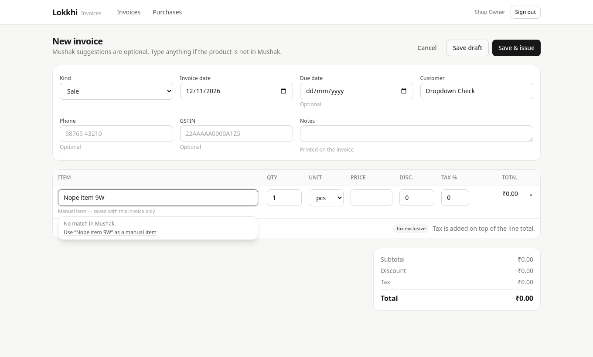

# Creating an invoice

Open **Invoices** and choose **New sale** or **New purchase**.

## Header

- **Kind** — sale or purchase. It decides the labels and the suggested price.
- **Invoice date** — defaults to today. It also decides the financial year.
- **Due date** — optional.
- **Customer / Supplier** — required, free text.
- **Phone and GSTIN** — optional, printed when present.
- **Notes** — optional, printed under the lines.

## Lines

Each line has an item name, quantity, unit, price, discount and tax rate. The
line total updates as you type, and the invoice totals sit below the table.

To add another line, choose **Add line**. To remove one, press the `×` on the
right.

You can type any item name you like. Nothing checks it against a catalogue
before saving.

## Saving

Two buttons:

- **Save draft** — keeps the invoice editable and unnumbered.
- **Save & issue** — saves, then assigns a number and freezes the invoice.

If a field is missing, Lokkhi explains what to fix and leaves the form open. It
does not discard your typing.

## Discounts

Discount is an **absolute amount** in currency, not a percentage. It is applied
to the line before tax. Lokkhi will not let the discount push a line below zero.

## Manual items

When a line has no Mushak link, the editor says:

> Manual item — saved with this invoice only

That is not an error. It is the normal, supported path for something you sold
before adding it to Mushak, or for a one-off item you will never stock again.
