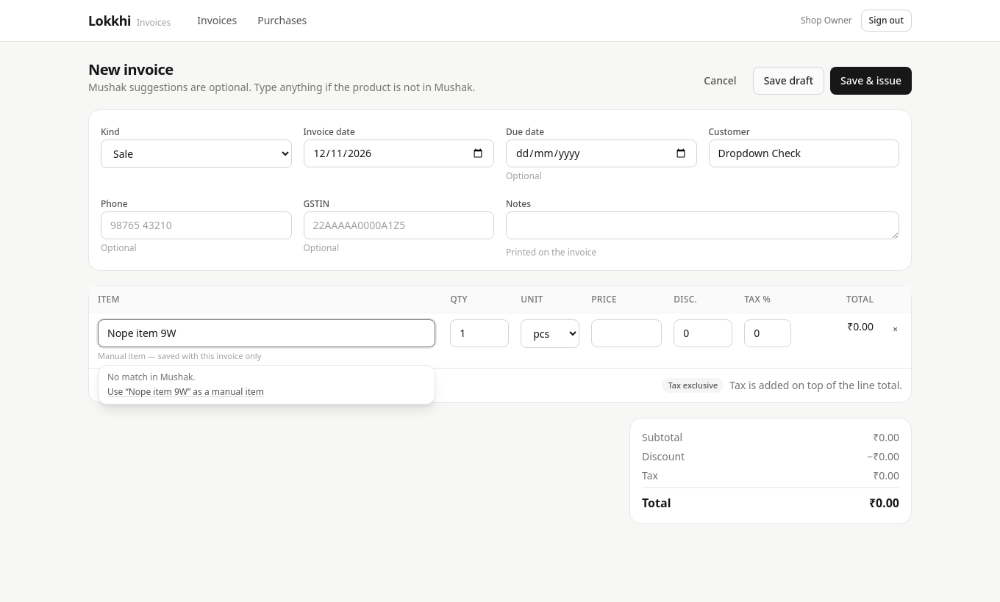

# Mushak suggestions

Start typing an item name and Lokkhi searches the Mushak catalogue after a short
pause. Results show the name, SKU, unit, stock and the price for this invoice
kind.

## Choosing a suggestion

Click a result. Lokkhi fills the line and links it to the Mushak product:

- sale invoices use the **selling price**
- purchase invoices use the **purchase price**
- unit, HSN and tax rate come from the catalogue

The editor then shows **Linked to Mushak** under the item name.

If you edit the item name afterwards, the line becomes a manual item again.
That is intentional: changing what you sold should not silently point the
invoice at a different product.

## When nothing matches

The dropdown says **No match in Mushak** and offers:

> Use “Emergency bulb 9W” as a manual item

Choose it, or simply keep typing. The invoice saves normally.

## When Mushak cannot be reached

The dropdown says:

> Mushak suggestions unavailable — you can still add this item.

The line is saved as a manual item. No retry is needed to finish the invoice.

## Why it works this way

A shop sometimes has to bill something that was never entered into the inventory
app. Blocking the bill would cost a sale. Lokkhi therefore treats Mushak as a
suggestion source and keeps the invoice valid on its own.

The trade-off: a manual line does not move Mushak stock. Lokkhi shows a subtle
hint afterwards so you can add it when convenient.
