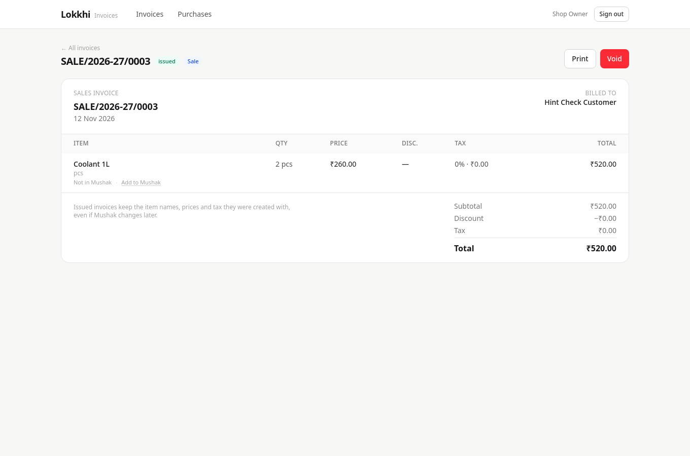
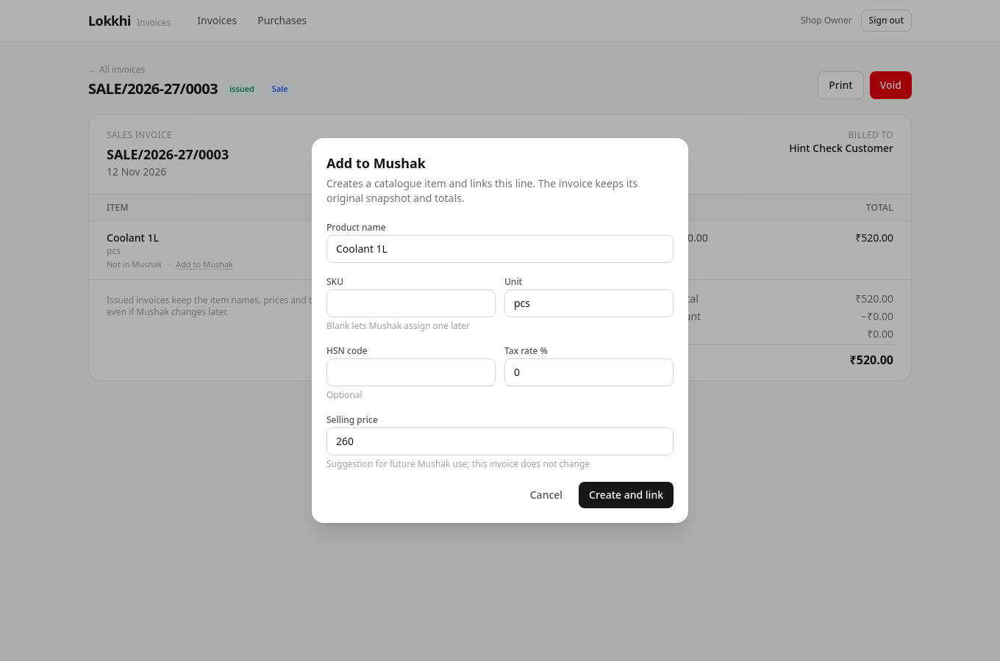

# Hints and Add to Mushak

Open any invoice from **Invoices**. Each line is checked against Mushak when the
page loads.

## The three line states

| State | What you see | What it means |
| --- | --- | --- |
| Linked | Nothing | The line points at a live Mushak product |
| Missing | **Not in Mushak** | The line was never linked, or the product was deleted |
| Archived | **Archived in Mushak** | The line points at a product that was archived |

Hints are deliberately quiet: small, grey text under the item name. They are not
warnings, they do not change the totals, and they never stop you printing or
voiding an invoice.

## Add to Mushak

A `Not in Mushak` line also shows a subtle **Add to Mushak** link. Clicking it
opens a small form pre-filled from the line:

- name
- SKU, if the line had one
- unit
- HSN code
- tax rate
- the price from this invoice

Nothing is created until you press **Create and link**.

On success, Lokkhi creates the Mushak catalogue item and an empty stock row, then
links this invoice line. The hint disappears.

## What Add to Mushak does not do

- It does **not** rewrite the invoice. The line keeps its original name, price,
  tax and totals, so a printed copy stays valid.
- It does **not** add opening stock. History is not back-filled; the invoice was
  issued before the product existed in Mushak.
- It does **not** apply a stock movement for this invoice. If you want stock to
  move, use Mushak normally from then on.

## Duplicates

If the SKU is already used, Lokkhi keeps the dialog open and says so. Nothing is
created and the invoice is untouched. Clear the SKU or use a different one.

## Archived products

An archived product is not deleted. Lokkhi shows `Archived in Mushak` and offers
no Add link, because the product already exists. Reactivate it in Mushak if it is
back in use.
