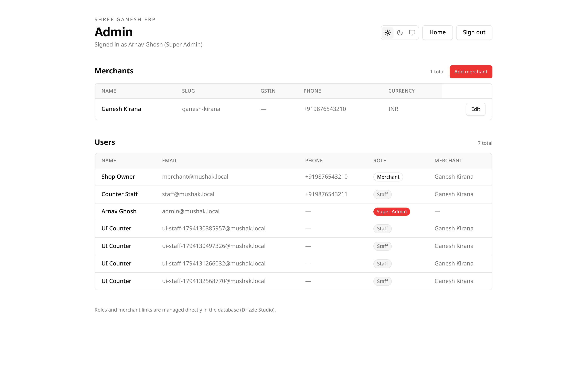

# Admin guide

The admin area is for the platform team, not for shop owners. It lists every
shop and every account and lets a platform administrator create a shop with its
first owner.



## Who can open it

| Role | Admin area | Notes |
| --- | --- | --- |
| `super_admin` | Yes | Full platform access. |
| `dev` | Yes | Same admin screens; intended for support. |
| `merchant` | No | Redirected to the shop area. |
| `staff` | No | Redirected to the shop area. |

Platform accounts sign in through the same `/login` screen and land on
`/admin`. A shop account that opens `/admin` sees a 403 page.

## The two lists

### Merchants

Every shop, with name, slug, GSTIN, phone and currency. Each row has **Edit**.

**Add merchant** creates a shop and its first owner in one step.

### Users

Every account across the platform, with name, email, phone, role and the shop it
belongs to. The list is read-only; roles and shop links are managed directly in
the database with Drizzle Studio.

## First administrator

Before the first sign-in, seed a super admin from the backend environment:

```bash
# mushak/backend/.env
ADMIN_NAME=Super Admin
ADMIN_EMAIL=admin@mushak.local
ADMIN_PASSWORD=a-strong-password
```

Then run:

```bash
npm run seed:admin
```

The script creates the account if it does not exist, or repairs the existing
account by setting `role=super_admin`, clearing the shop link and unbanning it.
It is safe to run again.

## Common tasks

| Task | Where |
| --- | --- |
| Create a shop and owner | [Managing merchants](merchants.md#create-a-shop-and-owner) |
| Change a shop's name, slug or currency | [Managing merchants](merchants.md#edit-a-shop) |
| Add another owner to a shop | [Managing users](users.md#add-a-shop-owner) |
| Create a platform or shop user from the CLI | [Managing users](users.md#create-a-user-from-the-cli) |
| Inspect roles and shop links | [Managing users](users.md#roles-and-shop-links) |
| Check service health | [Operations troubleshooting](../operations/troubleshooting.md) |

## Security notes

- The admin area is not linked from the shop sidebar.
- Platform roles cannot call the merchant API; they go through `/api/admin`.
- Shop roles cannot call the admin API.
- Merchant ids always come from the session for shop users.
- The admin API requires the `super_admin` or `dev` role.
- Use a unique password for the seeded administrator and change the example
  values before a real deployment.

## Limits of the current admin UI

- Users cannot be edited, banned or impersonated from the screen.
- Shops cannot be deleted from the screen.
- Owner passwords cannot be reset from the screen; use **Reset password** in the
  shop's Staff screen, or the API/CLI.
- There is no audit log of admin actions beyond the database timestamps.

Use [Drizzle Studio](../operations/setup.md#inspect-the-database) for the
remaining operations, and take a backup first.
