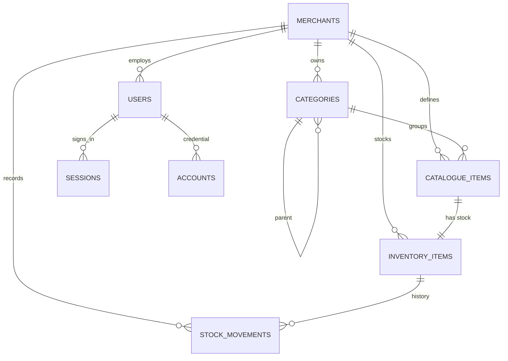

# Data model

Mushak stores shop data in PostgreSQL with Drizzle ORM. The important split is
between a **catalogue item** (what a product is) and an **inventory item** (how
much is on hand).

## Entity relationship



## Domain tables

### `merchants`

One shop.

| Column | Type | Notes |
| --- | --- | --- |
| `id` | uuid | Primary key |
| `name` | text | Required |
| `slug` | text | Required, unique |
| `gstin` | text | Nullable |
| `phone` | text | Nullable |
| `currency` | text | Default `INR` |
| `address` | jsonb | `Record<string, string>` |
| `profile_image_key` | text | Nullable object key |
| `created_at`, `updated_at` | timestamptz | Required |

Unique index: `merchants_slug_idx` on `slug`.

### `categories`

Product groups, scoped to a shop.

| Column | Type | Notes |
| --- | --- | --- |
| `id` | uuid | Primary key |
| `merchant_id` | uuid | FK → `merchants`, cascade delete |
| `parent_id` | uuid | FK → `categories`, set null on delete |
| `name` | text | Required |
| `created_at`, `updated_at` | timestamptz | Required |

Unique index: `(merchant_id, name)`. Index on `merchant_id`.

### `catalogue_items`

The product definition.

| Column | Type | Notes |
| --- | --- | --- |
| `id` | uuid | Primary key |
| `merchant_id` | uuid | FK → `merchants`, cascade |
| `category_id` | uuid | FK → `categories`, set null |
| `name` | text | Required |
| `sku` | text | Nullable, unique per shop |
| `barcode` | text | Nullable, unique per shop |
| `unit` | text | Default `pcs` |
| `hsn_code` | text | Nullable |
| `tax_rate` | numeric(5,2) | Default 0 |
| `purchase_price` | numeric(12,2) | Default 0 |
| `selling_price` | numeric(12,2) | Default 0 |
| `attributes` | jsonb | `Record<string, string>` |
| `image_key` | text | Nullable object key |
| `is_active` | boolean | Default true; archive flag |
| `created_at`, `updated_at` | timestamptz | Required |

Unique indexes: `(merchant_id, sku)` and `(merchant_id, barcode)`. Indexes on
`merchant_id` and `category_id`.

### `inventory_items`

Stock state for one catalogue item.

| Column | Type | Notes |
| --- | --- | --- |
| `id` | uuid | Primary key |
| `merchant_id` | uuid | FK → `merchants`, cascade |
| `catalogue_item_id` | uuid | FK → `catalogue_items`, cascade, unique |
| `stock_qty` | numeric(14,3) | Cached on-hand quantity, default 0 |
| `reorder_level` | numeric(14,3) | Default 0; 0 disables the warning |
| `image_key` | text | Nullable stock picture |
| `created_at`, `updated_at` | timestamptz | Required |

Unique index: `(catalogue_item_id)`. The one-to-one link is enforced by the
database, so a definition cannot have two stock rows.

### `stock_movements`

Append-only history.

| Column | Type | Notes |
| --- | --- | --- |
| `id` | uuid | Primary key |
| `merchant_id` | uuid | FK → `merchants`, cascade |
| `inventory_item_id` | uuid | FK → `inventory_items`, cascade |
| `type` | enum | See below |
| `quantity` | numeric(14,3) | Signed change |
| `unit_cost` | numeric(12,2) | Nullable |
| `reference_type` | text | Reserved for future documents |
| `reference_id` | uuid | Reserved |
| `note` | text | Nullable |
| `created_at` | timestamptz | Required, no `updated_at` |

Indexes: `(inventory_item_id, created_at)` and `merchant_id`.

`stock_movement_type` enum:

```
purchase, sale, return_in, return_out,
adjustment, damage, transfer_in, transfer_out
```

## Authentication tables

| Table | Purpose |
| --- | --- |
| `users` | Account, role, shop link, ban state, staff permissions |
| `sessions` | Database sessions with expiry and impersonation marker |
| `accounts` | Better Auth credential records and password hash |
| `verifications` | Email verification and reset tokens |

### `users` additions to Better Auth

| Column | Notes |
| --- | --- |
| `role` | `super_admin`, `dev`, `merchant` or `staff`; check constraint |
| `merchant_id` | FK → `merchants`, cascade; set for shop roles |
| `staff_permissions` | jsonb array, default `["stock"]`; ignored for merchants |
| `phone_number` | Unique when present |
| `banned`, `ban_reason`, `ban_expires` | Deactivation |

Unique indexes: `users_email_idx` and `users_phone_number_idx`.

## Invariants

1. Every inventory row points at exactly one catalogue item.
2. Every movement points at one inventory row and carries its shop id.
3. `inventory_items.stock_qty` equals the sum of that row's movement quantities.
4. A movement and the stock update are written in one transaction.
5. Archived products keep their rows and history.
6. Deleting a shop cascades to everything it owns.
7. Deleting a category sets `category_id` to null on its products.

## Lifecycle

### Adding a product

```
INSERT catalogue_items
INSERT inventory_items (stock_qty 0)
[INSERT stock_movements (adjustment, opening stock) if stockQty > 0]
```

### Moving stock

```
SELECT inventory_items … FOR UPDATE
UPDATE inventory_items SET stock_qty = stock_qty + signed
INSERT stock_movements (type, signed quantity, note)
```

### Archiving

```
UPDATE catalogue_items SET is_active = false
```

No rows are deleted. Restoring sets `is_active = true`.

### Deleting a category

```
DELETE categories
-- catalogue_items.category_id becomes null via ON DELETE SET NULL
```

## Where to look

- Schema: `mushak/backend/src/db/schema.ts`
- Migrations: `mushak/backend/drizzle/`
- Query code: `mushak/backend/src/routes/`
- ER diagram rendering: any Mermaid-capable Markdown viewer
