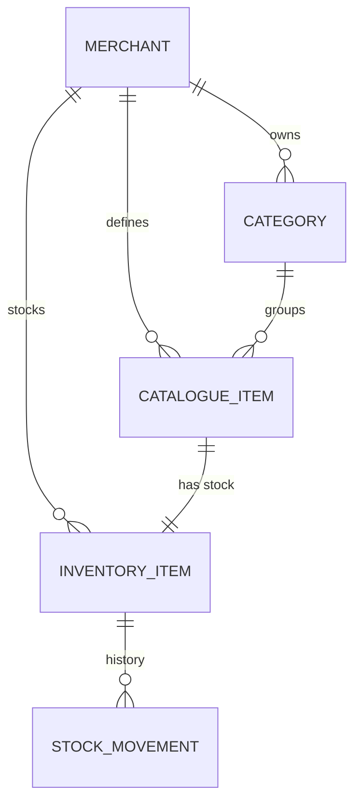

# How Mushak organises your shop

Mushak separates **what a product is** from **how much of it you have**. That is
the most important idea in the app, and it explains why there are two similar
tabs.

## One product, two records

Every product has:

- a **catalogue item** — name, SKU, barcode, category, unit, HSN code, GST,
  purchase price and selling price;
- an **inventory row** — on-hand quantity, low-stock level, and an optional
  stock photo.

The two records are linked one-to-one. A product definition can exist with no
stock (for example, a new item you have not purchased yet), but every inventory
row belongs to a definition.

As a result:

- Adding a product on **Inventory** also creates the catalogue entry.
- Adding a product on **Catalogue** also creates an inventory row at **0**.
- Both tabs show the same products; they show different columns and actions.
- Editing name, price, GST, SKU or category from either tab updates the shared
  definition.

> **Why two images?** The catalogue image is the product picture. The inventory
> image is optional and belongs to the stock row. Inventory rows show their own
> image when set and otherwise fall back to the catalogue image.

## The screens

| Screen | What it is for | Who can change things |
| --- | --- | --- |
| **Dashboard** | Stock totals, low stock and movement widgets for a chosen period | Nobody; it is a summary |
| **Report** | Printable shop summary for a chosen period | Nobody; it is a read-only view |
| **Inventory** | Stock quantities, values and reorder levels | Catalogue permission to add; Stock permission to move stock |
| **Catalogue** | Product definitions, prices, GST, archive | Catalogue permission |
| **Stock** | Full movement history | Stock permission to view |
| **Categories** | Product groups | Categories permission |
| **Staff** | Counter accounts and permissions | Shop owner only |
| **Settings** | Shop name, address, currency, profile picture | Shop owner only |

## Roles

| Role | Scope | Typical person |
| --- | --- | --- |
| `merchant` | One shop | The owner |
| `staff` | One shop, limited | Counter helper |
| `super_admin` | All shops | Platform owner |
| `dev` | All shops, support | Platform helper |

A **merchant** always has every shop permission. A **staff** account only has
the boxes the owner ticked: `stock`, `catalogue`, `categories`. Staff can always
**view** the dashboard, catalogue and inventory; the permissions control what
they can change. Staff can never open Settings or Staff, even with every
permission.

See the [permissions matrix](../reference/permissions.md) for the full table.

## Archived is not deleted

Archiving sets the product to inactive. It disappears from both lists unless
**Show archived** is ticked. Stock rows and movement history are kept, and you
can restore the product later.

A category can be deleted outright. Products in it are not deleted; they become
uncategorised.

## Money, quantities and GST

- Prices are stored as decimal numbers and shown with the shop currency.
- GST is a percentage from `0` to `100`.
- Stock quantities allow three decimal places, so `0.250 kg` is valid.
- Units are fixed values: `pcs`, `kg`, `g`, `litre`, `ml`, `box`, `packet`,
  `dozen`, `bundle`, `metre`, `sqft`.
- Mushak records prices and tax rates; it does not calculate tax returns.

## What happens when you save

Changes are written immediately. There is no separate "publish" step. If two
people edit the same product, the last save wins. Reload the list if someone
else may have changed it.
