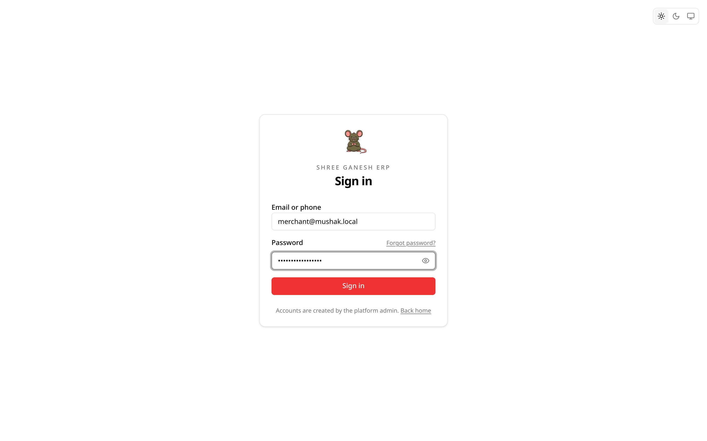

# Getting started

## Open Mushak

Your shop is reached through the web address your administrator gave you. For a
local development install the usual addresses are:

- App: `http://localhost:5173`
- API and Swagger UI: `http://localhost:8080` and
  `http://localhost:8080/docs`

The home page shows the sign-in button, or shortcuts to the shop or admin area
when you are already signed in.

## Sign in

1. Enter your **email** or your **phone number**.
2. Enter your password.
3. Select **Sign in**.

Both forms use the same password. Phone numbers may be typed as
`98765 43210`, `9876543210`, or `+919876543210`; Mushak normalises them.

After signing in:

- a shop account goes to `/app` (the Dashboard);
- a platform account goes to `/admin`.

If you are already signed in, opening `/login` redirects you into the app.

### Sign-in problems

| Message | What it means |
| --- | --- |
| Invalid email/phone or password | Check the identifier and password. |
| Too many attempts | Rate limiting is active in that deployment. Wait a minute. |
| This account has been deactivated | The shop owner or an administrator disabled the account. |
| The server is not responding | The backend is not running. See [Troubleshooting](11-troubleshooting.md). |

## Reset a forgotten password

1. On the sign-in screen choose **Forgot password?**
2. Enter the email address on the account.
3. Open the link in the reset email and choose a new password.

In development, no email is delivered. `MAIL_DRIVER=console` prints the message
in the backend terminal and saves it under `/tmp/mushak-mail` by default. Open
the `.eml` or `.json` file and copy the reset link.

The reset link is single-use and expires. Request a new one if it is rejected.

> Password reset needs an **email address** on the account. Phone-only accounts
> must ask the shop owner for a password reset from the Staff screen.

## Install Mushak on a phone

Mushak is a Progressive Web App.

- **Android / Chrome:** open the browser menu and choose **Add to Home screen**.
- **iPhone / Safari:** tap **Share**, then **Add to Home Screen**.

It then opens without browser chrome, like an app. A data connection is still
required because stock is stored on the server.

## Use it on the shop Wi‑Fi

The development frontend listens on all interfaces. A phone on the same Wi‑Fi
can open `http://<laptop-lan-ip>:5173`. During development the backend trusts
the machine's LAN addresses automatically.

For a deployed frontend on a different host or port, add it to
`TRUSTED_ORIGINS` in the backend environment. Also allow that origin in the
storage bucket; the backend writes the bucket CORS policy on first use.

## Theme

The sun/moon button switches between light and dark. The choice is remembered on
the device and applies to the sign-in screen, the shop, and admin.

## Sign out

Use **Sign out** at the bottom of the sidebar (desktop), in the mobile header, or
on the home page. Signing out clears the session from the device.

Sessions last up to 30 days and are refreshed while you use the app. Deactivating
a staff account or resetting its password signs that account out everywhere
immediately.

## First-run setup

A new installation needs a platform administrator and at least one shop. See
[Local setup](../operations/setup.md) and the
[admin guide](../admin-guide/README.md). Shop accounts cannot be created from
the public sign-in screen; they are provisioned by an administrator or the shop
owner.
