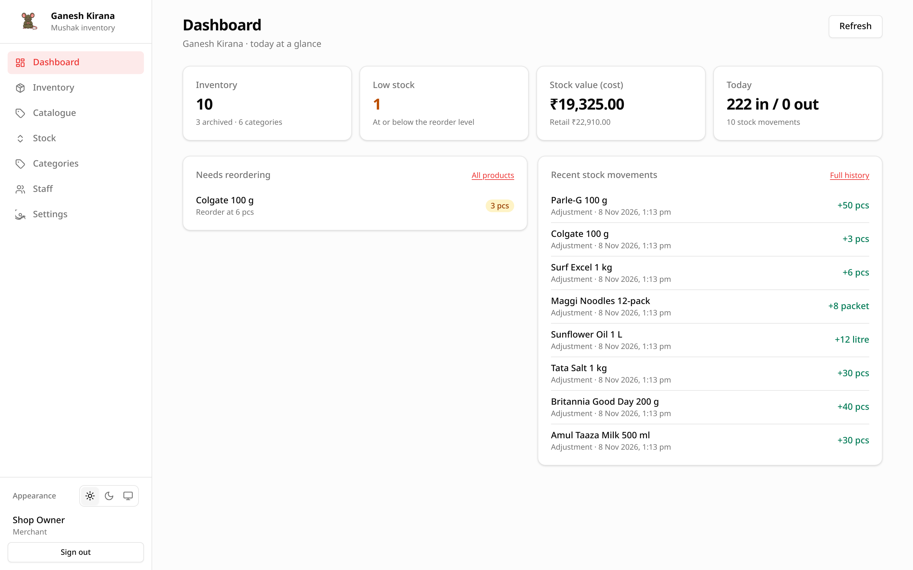

# Dashboard

The Dashboard is the first screen after signing in. It answers: *what needs my
attention today?*

## The four summary cards

| Card | What it counts |
| --- | --- |
| **Inventory** | Active product definitions. The hint shows archived products and the number of categories. |
| **Low stock** | Active products whose on-hand quantity is at or below their low-stock level. |
| **Stock value (cost)** | `on-hand × purchase price`, summed across all stock rows. The hint shows the same total at selling price. |
| **Today** | Total quantity moved in and out since local midnight, plus the number of movements. |

Notes:

- A low-stock level of `0` means "do not warn", so those products never appear
  in the low-stock count.
- Values are converted to the shop currency from **Settings**.
- The totals use the current stock rows, not historical cost layers.

## Needs reordering

The first list shows up to eight active products at or below their low-stock
level, lowest stock first. Each row shows the reorder level and the current
quantity.

Choose **All products** to open Inventory with the **Low stock only** filter
already applied.

## Recent stock movements

The second list shows the eight most recent movements with the product name,
movement reason and time. Choose **Full history** to open the Stock screen.

## Refresh

Choose **Refresh** after someone else has recorded stock or changed products.
The Dashboard does not poll automatically.

## Who can see it

Every signed-in shop account can open the Dashboard. Staff see the same shop
totals; there is no per-staff filtering.
