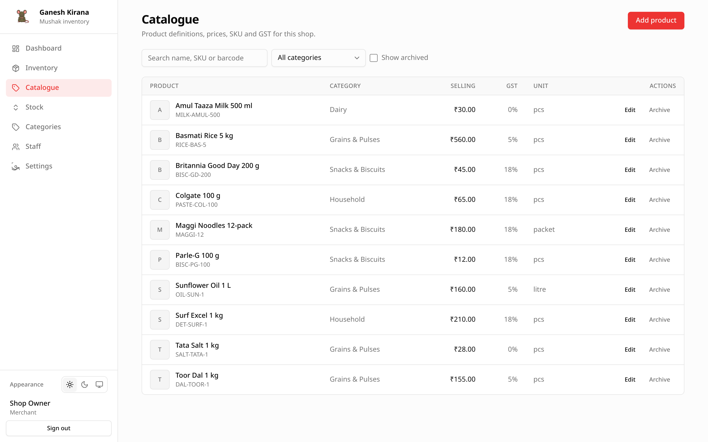

# Catalogue

The Catalogue tab holds the **product definitions** for your shop: names, SKU,
barcode, category, unit, HSN code, GST rate, purchase price and selling price.
It does not change stock quantities.

## Opening the screen

Choose **Catalogue** in the sidebar. Every product definition in the shop is
listed alphabetically.

| Column | Shows |
| --- | --- |
| **Product** | Name, thumbnail, SKU and barcode. Archived rows carry an **Archived** badge. |
| **Category** | The assigned category, or a dash. |
| **Selling** | Selling price in the shop currency. |
| **GST** | Tax rate as a percentage. |
| **Unit** | `pcs`, `kg`, `litre` and so on. |
| **Actions** | **Edit** and **Archive**, or **Restore** for archived rows. Staff without catalogue permission see **View** instead. |

## Search and filters

- **Search** matches part of the name, SKU or barcode. Typing pauses briefly
  before the list reloads.
- **Category** narrows the list to one category.
- **Show archived** includes inactive products, which are normally hidden.

The filters combine. Clearing the search box and selecting **All categories**
shows everything active again.

## Add a product

Choose **Add product**. The same form is used on the Inventory tab; the only
difference is that adding from Catalogue never asks for opening stock.

| Field | Required | Notes |
| --- | --- | --- |
| **Name** | Yes | Up to 160 characters. Shown in every list and on bills later. |
| **Product image** | No | PNG, JPEG, WebP, GIF or AVIF, up to 5 MB. See [images](#images). |
| **Category** | No | Type an existing name or a new one. A new name is created when you save. Staff without the categories permission pick from a list instead. |
| **Unit** | Yes | Defaults to `pcs`. The unit is used for every stock movement of this product. |
| **SKU** | No | Leave blank to generate one from the name, e.g. `BASMATI-RICE-5`. |
| **Barcode** | No | Scan or type the printed barcode. Unique within the shop. |
| **HSN code** | No | Up to 16 characters, for reference. |
| **GST %** | No | `0` to `100`; defaults to `0`. |
| **Purchase price** | No | Cost per unit; defaults to `0`. |
| **Selling price** | No | Price per unit; defaults to `0`. |
| **Low-stock level** | No | Reorder point, in the product's unit. `0` disables the warning. |
| **Opening stock** | Only on Inventory | Not shown when adding from Catalogue. |

Saving creates **two rows**: the catalogue definition and a linked inventory row
with **0** stock. The product immediately appears on both tabs.

### SKU rules

- A SKU is unique per shop, not globally.
- Generated SKUs use letters, numbers and dashes, keep Indic scripts intact,
  and shorten to 24 characters.
- If the generated name is taken, Mushak appends `-2`, `-3`, and so on.
- You can replace a generated SKU later; it must still be unique.

### Barcode rules

- Barcodes are optional and unique per shop when present.
- A duplicate produces a conflict message naming the field.
- Barcodes are not used to generate SKUs.

## Edit a product

Choose **Edit** on a row. The dialog opens with the current values. Changes
apply to the shared definition, so they also show on the Inventory tab and the
product detail page.

Editing a definition **never changes stock quantity**. To move stock, use the
Inventory tab's **Stock** action or the product detail page.

If the product is archived, restore it first; archived products have no Edit
action.

## Archive and restore

**Archive** asks for confirmation, then marks the product inactive.

- It disappears from both tabs unless **Show archived** is ticked.
- Stock rows and movement history are kept.
- Stock cannot be moved while the product is archived.
- The Dashboard stops counting it as active.

To bring it back, tick **Show archived**, then choose **Restore** on the row.
The product returns with the same stock quantity it had before archiving.

Archiving is a soft delete. Mushak does not permanently delete catalogue items
from the interface.

## Images

A product image is optional and stored outside the database in object storage.

- Accepted formats: PNG, JPEG, WebP, GIF and AVIF, up to 5 MB from the UI.
- The API's direct upload path accepts up to 25 MB, but the browser form limits
  files to 5 MB.
- In the list, a missing image shows the first letter of the product name.
- On the product detail page the image is shown as a hero picture.
- Removing the image in the form clears the key when you save.

The inventory row has its own optional picture. The Inventory list shows the
inventory picture first and falls back to the catalogue picture. See
[Inventory](05-inventory.md#images).

If uploads fail, see [Troubleshooting](11-troubleshooting.md#image-uploads-fail).

## Permissions

| Action | Merchant | Staff with `catalogue` | Staff without `catalogue` |
| --- | --- | --- | --- |
| View the list | Yes | Yes | Yes |
| Add a product | Yes | Yes | No |
| Edit a definition | Yes | Yes | No |
| Archive or restore | Yes | Yes | No |
| Set opening stock | Yes | Only with `stock` | No |

Staff without catalogue permission see a **View** action that opens the product
detail page. They can still search and filter.

## Worked example: adding rice

1. Choose **Add product**.
2. Name: `Basmati rice 5 kg`.
3. Category: `Grains`. The category is created if it does not exist.
4. Unit: `kg`.
5. Leave SKU blank. Mushak generates `BASMATI-RICE-5`.
6. GST: `5`. Purchase price: `95`. Selling price: `120`.
7. Low-stock level: `10`.
8. Save.

The Catalogue row appears with 0 stock. Open Inventory and use **Stock** to
record the purchase. The product detail page then shows both the definition and
the movement history.
