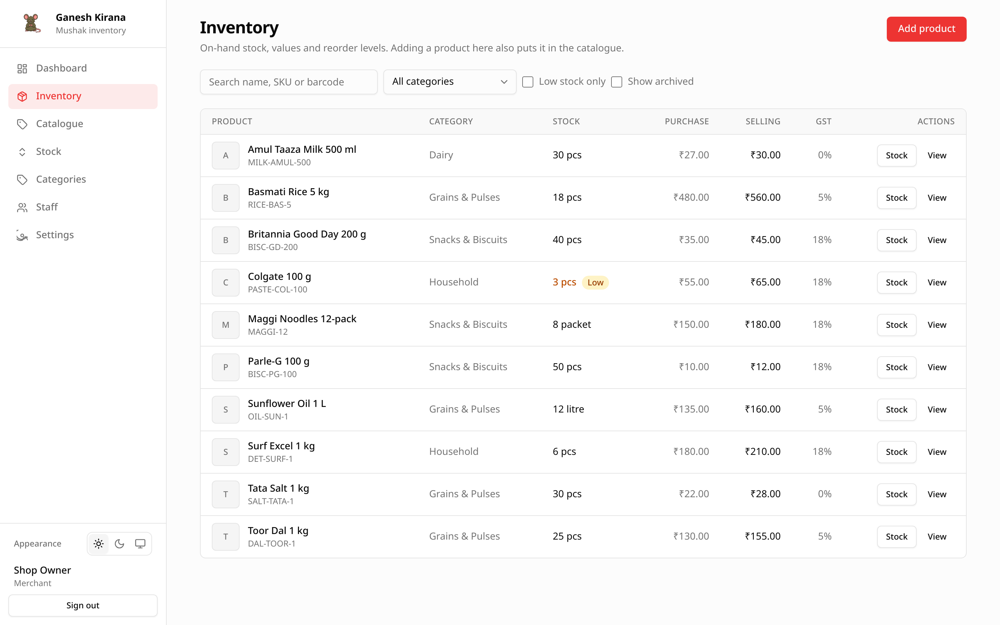
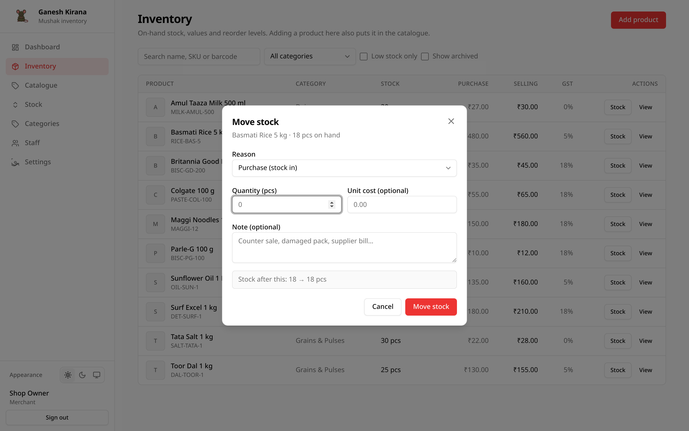

# Inventory

Inventory is the working screen for stock. It shows every product with its
on-hand quantity, reorder level and value, and it is where stock movements are
recorded.

## Opening the screen

Choose **Inventory** in the sidebar. The list is alphabetical and includes every
active product, including products with zero stock.

| Column | Shows |
| --- | --- |
| **Product** | Thumbnail, name, SKU and barcode. Archived rows carry an **Archived** badge. |
| **Category** | The assigned category, or a dash. |
| **Stock** | On-hand quantity and unit. Amber with a **Low** badge at or below the reorder level. |
| **Purchase** | Purchase price per unit. |
| **Selling** | Selling price per unit. |
| **GST** | Tax rate. |
| **Actions** | **Stock** and **View**. |

## Search and filters

- **Search** matches the name, SKU or barcode.
- **Category** limits the list to one category.
- **Low stock only** shows only products whose reorder level is above zero and
  whose quantity is at or below that level.
- **Show archived** includes archived products.

The Dashboard's **All products** link opens this screen with **Low stock only**
already ticked.

## Stock versus catalogue

Inventory and Catalogue show the same products but different things:

- **Inventory** focuses on quantities, reorder levels and stock actions.
- **Catalogue** focuses on definitions, prices and archive/restore.

Adding a product on either tab creates both rows. Adding on Inventory also lets
you enter opening stock and a reorder level in the same step.

## Add a product

Choose **Add product**. The form is the same as the
[Catalogue form](04-catalogue.md#add-a-product), with two additions:

| Field | Notes |
| --- | --- |
| **Opening stock** | Quantity already on hand. Recorded as an `adjustment` movement with the note `Opening stock`. Requires the `stock` permission; other users see `0`. |
| **Low-stock level** | Reorder point for this stock row. `0` means no warning. |

Saving creates the catalogue definition and the stock row together. The opening
quantity is also written to the movement history, so the total is explainable.

## Move stock

Choose **Stock** on a row. If the button is missing you either lack the `stock`
permission or the product is archived.

| Field | Notes |
| --- | --- |
| **Reason** | One of the movement types below. |
| **Direction** | Only for **Adjustment**: increase or decrease. |
| **Quantity** | Must be greater than zero, up to three decimal places. |
| **Unit cost** | Optional, only shown for **Purchase**. Stored on the movement, not copied to the product's purchase price. |
| **Note** | Optional, up to 280 characters, e.g. `Counter sale` or `Damaged pack`. |

The dialog previews the resulting quantity before you save. If the result would
be negative, Mushak refuses the movement with a message like
`Only 4 pcs in stock, cannot remove 5`.

### Movement types

| Reason | Direction | Typical use |
| --- | --- | --- |
| `purchase` | In | Stock received from a supplier. |
| `sale` | Out | Sold at the counter. |
| `return_in` | In | Customer returned goods. |
| `return_out` | Out | Goods returned to a supplier. |
| `damage` | Out | Breakage, expiry, loss. |
| `adjustment` | Either | Stock-take correction or opening stock. |
| `transfer_in` | In | Received from another location. |
| `transfer_out` | Out | Sent to another location. |

Every movement is stored with a signed quantity (`+10`, `-2`), the user who
recorded it and a timestamp. See [Stock movements](07-stock-movements.md).

### What cannot be changed

- Stock quantity is never edited directly. Every change is a movement.
- Archived products must be restored before stock can move.
- Removing more than is on hand is rejected.
- There is no undo. Record the opposite movement instead, e.g. a `return_in`
  after a mistaken `sale`.

## View a product

Choose **View** to open the [product detail page](06-product-detail.md). It
combines the definition, the current stock and the last movements for that
product, and offers the same **Stock** and **Edit** actions where permitted.

## Images

An inventory row can have its own picture, separate from the catalogue picture.
It is useful when the same definition is stocked in different packaging.

- The Inventory list prefers the inventory picture, then the catalogue picture.
- The product detail page shows the catalogue picture as the hero image.
- Both are optional and are uploaded to object storage.

## Permissions

| Action | Merchant | Staff with `stock` | Staff with `catalogue` only |
| --- | --- | --- | --- |
| View the list | Yes | Yes | Yes |
| Move stock | Yes | Yes | No |
| Add a product | Yes | Only with `catalogue` | Yes |
| Enter opening stock | Yes | Only with `stock` | No |
| Edit details | Via Catalogue | Via Catalogue | Via Catalogue |

Staff always see the Inventory tab so they can look up quantities. The buttons
they see depend on the permissions the owner ticked.

## Worked example: receiving a delivery

1. Open **Inventory** and find `Basmati rice 5 kg`.
2. Choose **Stock**.
3. Reason: **Purchase (stock in)**.
4. Quantity: `25`.
5. Unit cost: `95`.
6. Note: `Supplier bill 1042`.
7. Save.

The quantity rises by 25, the movement appears on the Stock screen and the
Dashboard's **Today** card includes it.
