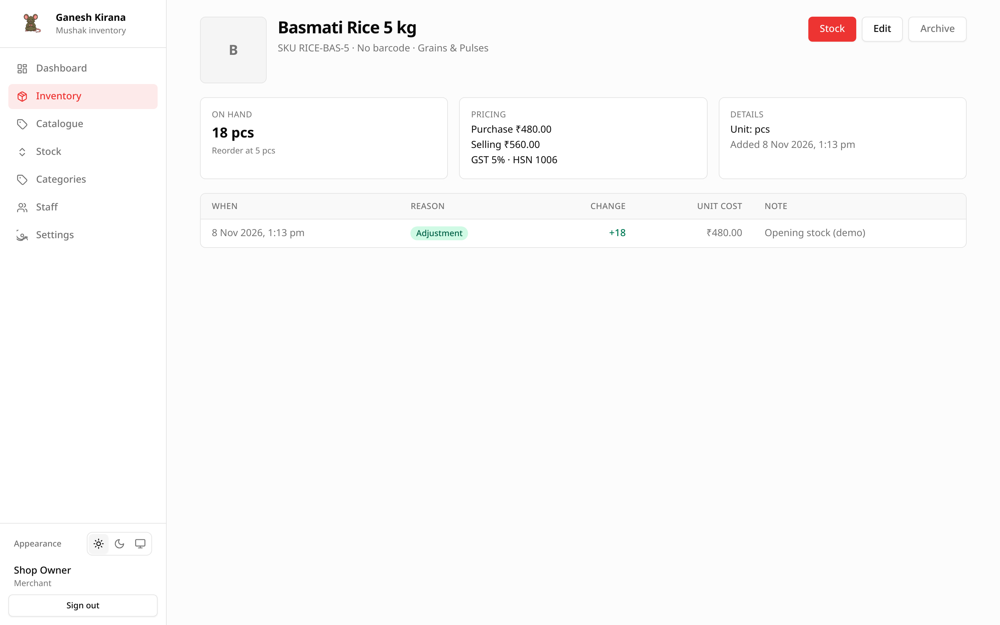

# Product detail

The product detail page combines everything Mushak knows about one product: its
definition, its stock, and its recent movements.

## Opening the page

Open it from **Inventory** with **View**, or from **Catalogue** with **View**
(for staff without catalogue permission). The address is
`/app/inventory/<inventory-row-id>`.

The page is scoped to your shop. A product from another shop returns **not
found**.

## What the page shows

### Header

- Product image, or the first letter of the name when there is no image.
- Product name.
- A line with the SKU (or `No SKU`), the barcode (or `No barcode`) and the
  category (or `Uncategorised`).
- **Stock**, **Edit** and **Archive** buttons where you have permission.

### Summary cards

| Card | Contents |
| --- | --- |
| **On hand** | Current quantity and unit, a **Low stock** badge when applicable, and the reorder level. |
| **Pricing** | Purchase price, selling price, GST rate and HSN code. |
| **Details** | Unit and the date the product was added. |

### Movement history

The last 100 movements for this product, newest first. The table is only loaded
for accounts with the `stock` permission; everyone else sees an empty history.
The columns are:

| Column | Meaning |
| --- | --- |
| **When** | Date and time in your local time zone. |
| **Reason** | Purchase, sale, damage, adjustment and so on. |
| **Change** | Signed quantity in the product's unit. Increases are green, decreases red. |
| **Unit cost** | The cost recorded with the movement, or a dash. |
| **Note** | The note typed when the movement was recorded. |

When there are no movements the table shows
`No stock movements for this product yet.` The full shop-wide history is on the
[Stock screen](07-stock-movements.md).

## Actions

| Action | Permission | Effect |
| --- | --- | --- |
| **Stock** | `stock` | Opens the move-stock dialog. Hidden for archived products. |
| **Edit** | `catalogue` | Opens the same product dialog as the Catalogue tab. Does not change stock. Hidden for archived products. |
| **Archive** | `catalogue` | Archives the product after confirmation. Hidden for archived products. |

Archived products can be restored from the Catalogue tab with **Show archived**
ticked. Stock cannot be moved while a product is archived.

## Why a definition can have zero stock

The definition and the stock row are separate. A product added from the
Catalogue tab starts at zero and still has a detail page. This is normal: it
lets you prepare a product before the first delivery arrives.

## Permissions

Every shop account can open the detail page for its own shop. The action
buttons follow the same rules as the lists:

- staff with `catalogue` can edit and archive;
- staff with `stock` can move stock;
- staff with neither can still read the page.

## Printing and sharing

The detail page is a normal web page. Use the browser's print command to paper
or PDF it. Nothing is sent anywhere by printing.
