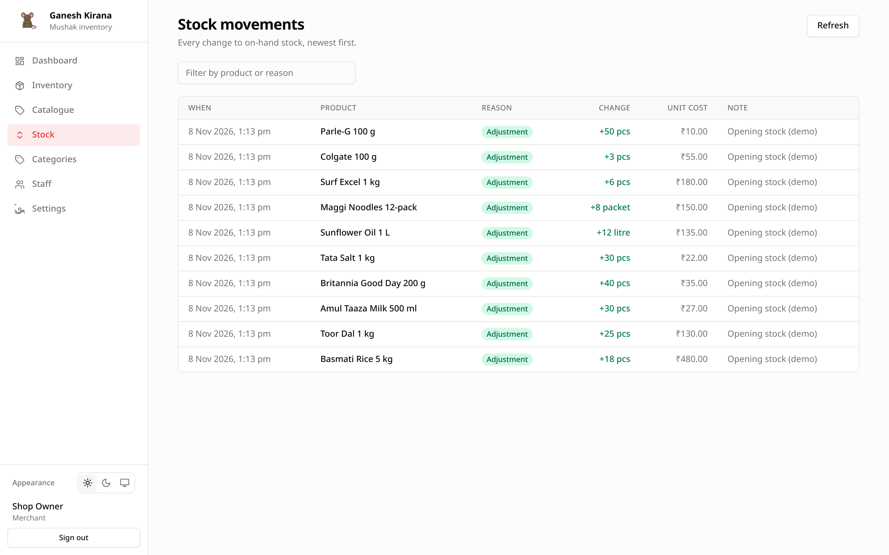

# Stock movements

The Stock screen is the shop-wide audit trail. Every quantity change made
anywhere in Mushak appears here, newest first.

## Opening the screen

Choose **Stock** in the sidebar. The screen loads the 200 most recent movements.
The sidebar entry and the screen itself require the `stock` permission; staff
without it do not see the page.

## What each row shows

| Column | Meaning |
| --- | --- |
| **When** | Date and time in your local time zone. |
| **Product** | Product name. |
| **Reason** | Purchase, sale, return, damage, adjustment or transfer. |
| **Change** | Signed quantity and unit. Green for stock in, red for stock out. |
| **Unit cost** | Cost recorded with the movement, when one was entered. |
| **Note** | Free text entered when the movement was recorded. |

The **Filter** box matches the product name, reason, note and quantity text.

## Where movements come from

| Source | Movement type | Note |
| --- | --- | --- |
| Opening stock when adding on Inventory | `adjustment` | Always `Opening stock`. |
| **Stock** on Inventory or the detail page | Chosen reason | Manual entry. |
| Future sales, purchases or transfers | Matching type | The schema already has reference fields for a document link. |

There are no automatic movements. Mushak does not decrement stock when you open
a bill, because there is no billing feature yet.

## Signed quantities

The number stored is always signed:

- `purchase`, `return_in`, `transfer_in` add stock;
- `sale`, `return_out`, `damage`, `transfer_out` remove stock;
- `adjustment` follows the direction you choose.

The API accepts a positive `quantity`; the type decides the sign. The UI shows
`+` for increases and a minus for decreases.

## Correcting a mistake

Movements are append-only. You cannot edit or delete one from the interface.

To correct an error, record the opposite movement with a clear note:

- recorded a sale of 5 by mistake → record `return_in` 5, note
  `Correction: sale entered twice`;
- received 10 but the invoice says 12 → record `purchase` 2, note
  `Short delivery correction`.

This keeps the history honest. The current quantity is the sum of all
movements.

## How the running total is kept

`inventory_items.stock_qty` is the current quantity, cached for fast lists and
dashboards. Each stock change updates that column and inserts a movement in the
same database transaction. If either step fails, neither is saved, so the cached
total cannot drift from the history.

## Retention

Movements are kept indefinitely. There is no pruning job. Back up the database
before a major upgrade; see
[Backups and upgrades](../operations/backups-and-upgrades.md).

## Permissions

| Action | Merchant | Staff with `stock` | Staff without `stock` |
| --- | --- | --- | --- |
| Open Stock | Yes | Yes | No |
| Record a movement | Yes | Yes | No |
| Read a product's history | Yes | Yes | Only via a permitted screen |

The product detail page also needs `stock` to show the movement table, because
the table is served by the movements endpoint.

## Worked example: reading a day

1. Open **Stock**.
2. Filter by the product name to see one item's day.
3. Compare the signed changes with the notes.
4. Open **Dashboard** to see the same quantities summarised as today's in and
   out totals.
