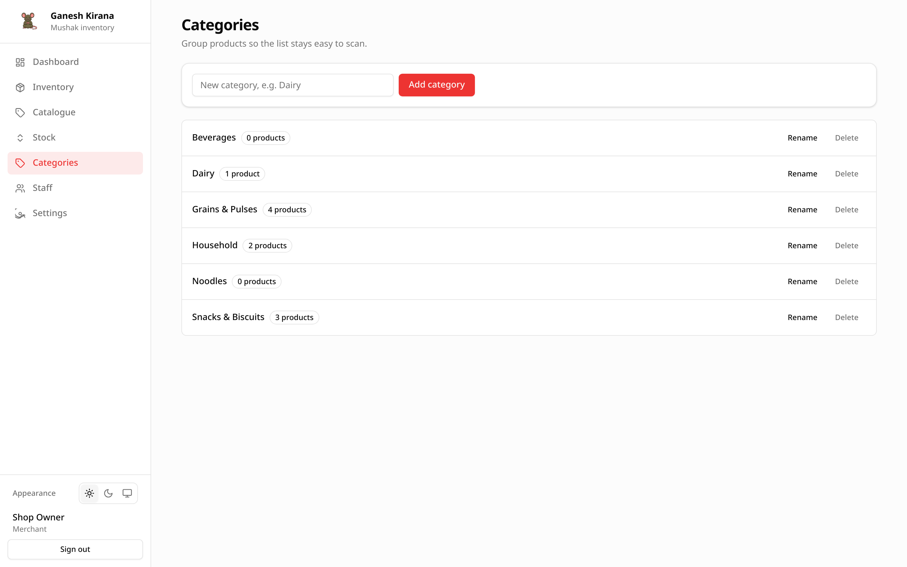

# Categories

Categories group products so long lists stay readable and the Catalogue and
Inventory filters are useful.

## Opening the screen

Choose **Categories** in the sidebar. Every category is listed with the number
of products assigned to it.

| Element | Meaning |
| --- | --- |
| **Name** | The category name. |
| **Badge** | `N product` or `N products`, counted across active and archived products. |
| **Rename** | Edit the name in place. |
| **Delete** | Remove the category after confirmation. |

## Add a category

1. Type a name in **New category**, e.g. `Dairy`.
2. Choose **Add category**.

Names are unique per shop. A duplicate shows
`A category with that name already exists`. Names are trimmed, capped at 80
characters, and can include spaces and Indic scripts.

You can also create a category without leaving the product form: type a new
name in the **Category** field and save the product. If you have the
`categories` permission the category is created; staff without it must pick an
existing category.

## Rename a category

1. Choose **Rename** on the row.
2. Change the name.
3. Press **Enter** or choose **Save**. **Escape** cancels.

Renaming does not move products. Every product using the category picks up the
new name immediately.

## Delete a category

Choose **Delete** and confirm. The confirmation tells you how many products
will become uncategorised.

- Products are **not** deleted.
- Their category becomes empty and the lists show a dash.
- Deleting a parent category leaves its children in place with no parent.

This cannot be undone. Recreate the category and reassign products by editing
each one if you delete by mistake.

## Parent categories

The API accepts a `parentId` when creating or updating a category, and the
database stores it. The Categories screen currently creates flat categories and
does not show a parent picker. Products are assigned to one category, not to a
whole branch.

If you build on the API, a parent must belong to the same shop. A category
cannot be its own parent.

## Permissions

| Action | Merchant | Staff with `categories` | Staff without `categories` |
| --- | --- | --- | --- |
| Open the Categories screen | Yes | Yes | No; the sidebar entry is hidden |
| Add, rename, delete | Yes | Yes | No |
| Create one from the product form | Yes | Yes | No; pick from the list |

Staff without the permission can still filter by category on the product
screens and see the category column. They cannot change the list. Opening
`/app/categories` directly shows the screen in read-only form, but the supported
path is to ask the owner for the permission.

## Worked example: reorganising a shop

1. Add `Dairy`, `Snacks`, `Grains` and `Household`.
2. Edit each product and choose the right category.
3. Open Catalogue and use the category filter to check that nothing is left
   uncategorised.
4. Rename `Snacks` to `Packaged food` if that reads better.
