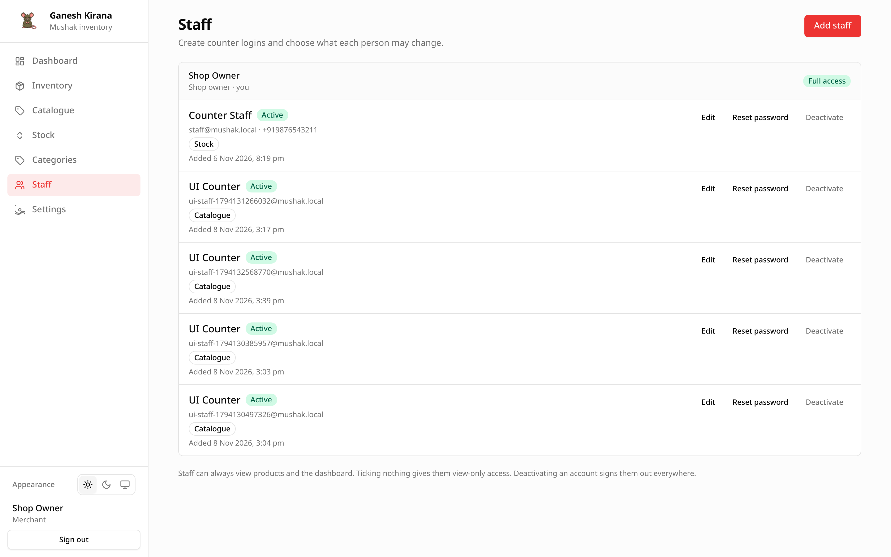

# Staff and permissions

The Staff screen lets a shop owner create counter accounts and decide what each
person may change. It is visible only to the merchant account that owns the shop.

## Opening the screen

Choose **Staff** in the sidebar. If the entry is missing, you are signed in as
staff; only the shop owner can manage accounts.

The screen starts with a card for the shop owner marked **Full access**, then
one card per staff account. Each staff card shows:

- name and an **Active** or **Deactivated** badge;
- email, and phone number when set;
- permission badges, or `View only · no changes` when none are ticked;
- the date the account was added;
- **Edit**, **Reset password**, and **Deactivate** or **Reactivate**.

## Create a staff account

Choose **Add staff** and fill in:

| Field | Required | Notes |
| --- | --- | --- |
| **Name** | Yes | Up to 120 characters. |
| **Email** | Yes | Used to sign in and to receive password resets. Must be unique. |
| **Phone (optional)** | No | Enables phone sign-in. Ten digits are stored with a `+91` prefix. |
| **Temporary password** | Yes | At least 8 characters, at most 128. |
| **What they can change** | No | Stock, Catalogue, Categories. Ticking nothing gives view-only access. |

The account can sign in immediately. There is no invitation email.

## Permissions explained

| Permission | Allows |
| --- | --- |
| **Stock** | Record stock movements and view the Stock history. |
| **Catalogue** | Add, edit and archive products; upload images; set opening stock when adding. |
| **Categories** | Create, rename and delete categories, including from the product form. |

Reading is always allowed. Every staff account can view the Dashboard, Catalogue
and Inventory, even with no permissions ticked. Settings and Staff remain
owner-only.

For the full action-by-action table see
[Permissions](../reference/permissions.md).

## Edit a staff account

Choose **Edit** to change:

- name;
- phone number;
- permission badges.

Email and status are not in this dialog. Email cannot be changed at all here;
create a new account and deactivate the old one if it must change. Use the
**Deactivate** / **Reactivate** button for status.

## Reset a password

1. Choose **Reset password** on the card.
2. Enter the new password and type it again.
3. Choose **Set password**.

The staff member is signed out on every device immediately and must use the new
password. The owner never sees the old password. This is also how a phone-only
account recovers access, because self-service reset needs an email address.

## Deactivate and reactivate

**Deactivate** asks for confirmation, then:

- the account cannot sign in;
- every existing session is deleted;
- the sign-in screen says the account has been deactivated;
- stock history and audit rows keep the account id.

**Reactivate** restores sign-in. Permissions and password are unchanged.

Deactivation is the supported alternative to deleting staff. The interface does
not delete accounts, which keeps history attributable.

## What staff cannot do

Even with every permission ticked, staff cannot:

- open **Settings** or change the shop profile;
- open **Staff** or manage other accounts;
- create another shop;
- access the platform admin area;
- see another shop's data.

The merchant id always comes from the signed-in session, never from the request.

## Sessions

- A session lasts up to 30 days and is refreshed while the account is used.
- Deactivating an account or resetting its password ends all sessions.
- Signing out clears the session on that device only.

## Worked example: a weekend helper

1. Choose **Add staff**.
2. Name `Sushrita Saha`, email `sushrita@shop.in`, phone `9876543210`.
3. Temporary password: at least eight characters.
4. Tick only **Stock**.
5. Save and tell Sushrita her sign-in details.

She can record sales and purchases but cannot change prices or add products.
Give her **Catalogue** later from **Edit** if the job grows.
