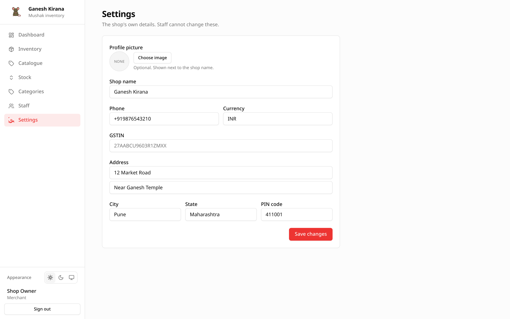

# Settings

Settings holds the shop's own details: name, contact information, currency,
address, GSTIN and profile picture. Only the shop owner can change them.

## Opening the screen

Choose **Settings** in the sidebar. Staff do not see the entry; if a staff
account opens the address directly, the page explains that only the owner can
change these details.

## Fields

| Field | Notes |
| --- | --- |
| **Profile picture** | Optional. Shown next to the shop name in the sidebar and mobile header. |
| **Shop name** | Required, up to 120 characters. Used across the app and in the admin list. |
| **Phone** | Optional, up to 24 characters. The shop's contact number, not a sign-in identifier. |
| **Currency** | Defaults to `INR`. Saved in upper case. Used as the label on every price and total. |
| **GSTIN** | Optional, up to 20 characters. Stored for reference; Mushak does not validate it against GST records. |
| **Address** | Five optional lines: line 1, line 2, city, state and PIN code. Saved as a structured address. |
| **PIN code** | Numeric keyboard on phones; not validated against a postal database. |

Leave a field blank to clear it. Clearing the profile picture removes the image
key when you save.

## Saving

Choose **Save changes**. On success the page shows `Shop settings saved.` and the
sidebar name and picture update without a reload.

Validation is deliberately light:

- the name cannot be empty;
- the currency, phone and GSTIN have length limits;
- the API accepts any string values in the address object.

## Currency

`currency` is a label, not a conversion. Changing it from `INR` to `USD` does not
convert stored prices; it only changes what the formatter prints. Set it before
entering prices, or update prices deliberately afterwards.

## Profile picture

The picture is optional and stored in object storage under the shop's own
prefix.

- A circular preview appears in the form.
- The sidebar avatar uses the same key.
- Removing it falls back to the shop initials or icon.
- If storage is not configured, the rest of Settings still saves; the image
  upload reports its own error.

See [Object storage](../operations/storage.md) for the server side.

## What Settings does not control

| Not here | Where |
| --- | --- |
| Users or passwords | [Staff](09-staff-and-permissions.md), or the platform admin |
| Tax rates | Per product, in [Catalogue](04-catalogue.md) |
| Stock levels | [Inventory](05-inventory.md) |
| Theme | Theme toggle in the header |
| Mail or storage servers | Backend environment; see [Configuration](../operations/configuration.md) |

## Permissions

| Action | Merchant | Staff |
| --- | --- | --- |
| Open Settings | Yes | No |
| Change shop details | Yes | No |
| Change the profile picture | Yes | No |

Platform administrators edit shops from the admin area instead; see
[Managing merchants](../admin-guide/merchants.md).

## Worked example: a new address

1. Open **Settings**.
2. Fill in line 1 `12 Market Road`, city `Pune`, state `Maharashtra`, PIN
   `411001`.
3. Set the phone to `+91 98765 43210`.
4. Save.
5. Check that the address is correct, then print a product page if you need the
   shop details on paper. Mushak does not print the address on stock screens.
