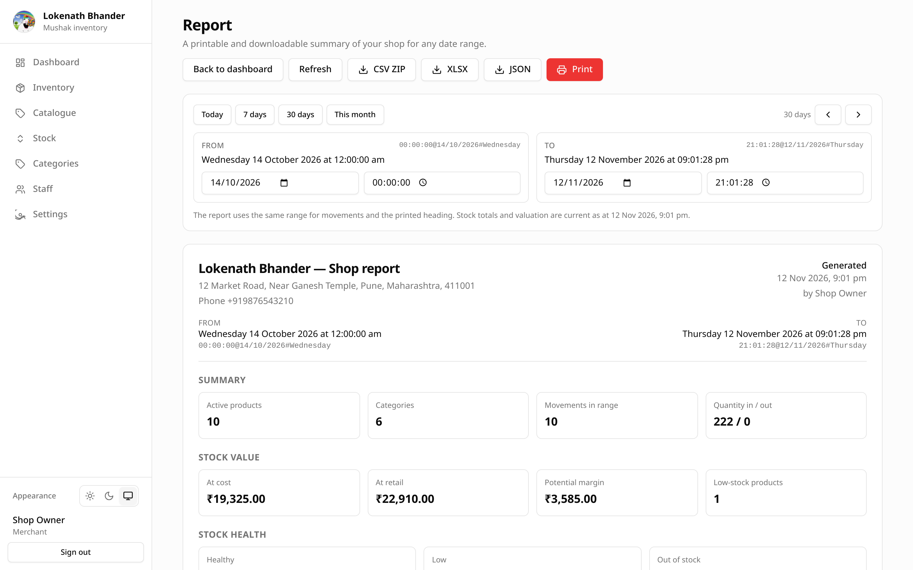

# Report

**Report** produces a printable or downloadable summary of the shop for a date
range. The page you see is the preview — there is no separate print dialog
window. Choose **Print** and use the browser's print dialog to send it to a
printer or choose **Save as PDF**, or download the same data as CSV files,
XLSX or JSON.

Open it from the **Report** button in the Dashboard header, or go to
`/app/report` directly.

## Choosing a range

The report uses the same range control as the Dashboard, with one difference:
it starts at the **last 30 days** instead of today.

- Presets: Today, 7 days, 30 days, This month.
- From and To accept a date and a time, including seconds.
- Previous and Next shift the window by its own length.

The range appears in the canonical `HH:MM:SS@DD/MM/YYYY#Weekday` form and as a
fluent label. It must end after it starts, and cannot exceed 366 days.

Movements are limited to the range. Stock totals and valuation are a snapshot
taken when the report is generated, so they are always current.

## What the report contains

1. **Shop identity** — name, address, phone and GSTIN, plus who generated it
   and when.
2. **Range** — From and To in both canonical and fluent forms.
3. **Summary** — active products, categories, movements in range, and quantity
   in/out.
4. **Stock value** — cost, retail, potential margin and low-stock count.
5. **Stock health** — healthy, low and out-of-stock counts.
6. **Category valuation** — products, cost and retail value per category,
   including Uncategorised.
7. **Needs reordering** — products at or below their reorder level.
8. **Out of stock** — products with no stock on hand and when they last changed.
9. **Top stock value** — the five products holding the most retail value.
10. **Stock movements** — every movement in the range, newest first. If there
    are more than 1,000, the report says so and shows the most recent 1,000;
    narrow the range for the complete list.

## Printing and saving a PDF

Choose **Print**. In the browser dialog:

- **Destination: Save as PDF** creates a file. This is the quickest way to email
  or archive the report.
- **Destination: a printer** prints on A4 with 14 mm margins.

The sidebar, top bar and page buttons are hidden automatically when printing.
The report also switches to a light palette, so printing from dark mode still
produces readable output. Table headers repeat if a long movement list spans
more than one page.

The browser sets the document title to `<shop> report — <range>`, which becomes
the default PDF filename.

## Downloading CSV, XLSX and JSON

The same report can be downloaded in three formats:

- **CSV ZIP** — a ZIP archive containing one UTF-8 CSV per section:
  `01-summary.csv`, `02-categories.csv`, `03-needs-reordering.csv`,
  `04-out-of-stock.csv`, `05-top-stock-value.csv` and `06-movements.csv`.
  Currency columns are plain numbers, with the currency code in the heading
  (for example `Retail (INR)`). Movement rows include an ISO timestamp column
  for re-importing.
- **XLSX** — an Excel workbook with one worksheet per section. Header rows are
  bold and frozen, and column widths are sized to the content.
- **JSON** — the report response exactly as the page received it, pretty-printed
  with the range, summary, stock-health, valuation, low-stock, out-of-stock,
  top-value and movement fields. Useful for scripts or for keeping a raw copy.

The downloads use the currently loaded report and range, and are named
`mushak-report-<from>-to-<to>.csv.zip`, `.xlsx` or `.json`. The movement sheet
is capped at 1,000 rows, exactly like the on-screen report; when the range
contains more, the Summary section and the screen both say so. Narrow the range
to export the full list.

The files are built in the browser from the report response, so there is no
server-side export job to wait for. Stock totals and valuation are the snapshot
shown on screen; download again after stock changes to get a newer snapshot.

## Refreshing

The report is generated when the page loads or the range changes. Choose
**Refresh** to fetch a new snapshot after stock changes.

## Who can see it

Every signed-in shop account can open the report, matching Dashboard access.
There is no per-staff filtering; staff see the same shop-wide figures.
